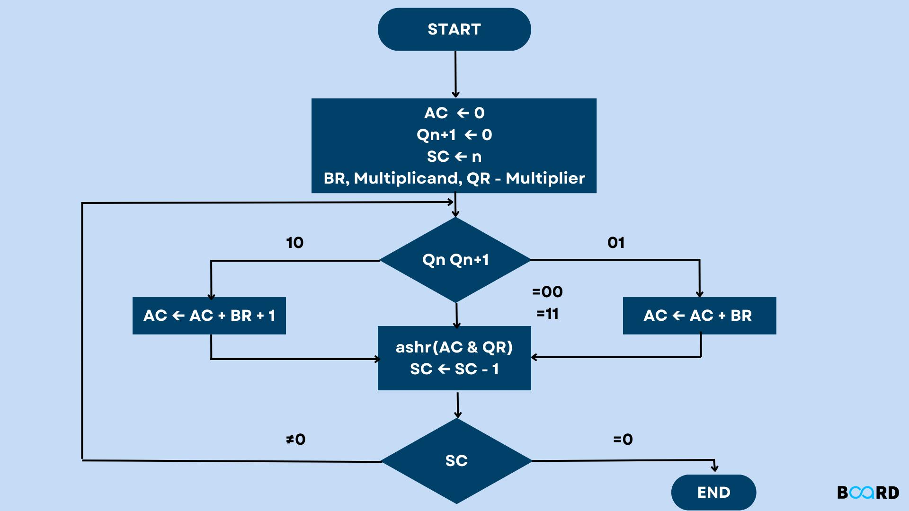

# Booth's 4-Bit Multiplication Algorithm Simulator

An interactive, browser-based educational simulator that demonstrates **Booth's Multiplication Algorithm** for signed 4-bit binary integers (`-8` to `+7`). The project is built with HTML5, CSS3, and Vanilla JavaScript. It visualizes two's complement conversion, register updates (`A`, `Q`, `Q₋₁`, and `M`), addition/subtraction decisions, arithmetic right shifts, and the final 8-bit binary and decimal product across four iterations.

> **Live Demo:** [Open Booth's 4-Bit Multiplication Simulator](https://booths4bitmultiplicationsimulator.vercel.app/)

## Algorithm Flowchart



## Project Details

- **Group:** Group B
- **Project Number:** 2
- **Subject Area:** Computer Organization and Architecture
- **Input Range:** Signed 4-bit integers (`-8` to `+7`)
- **Iterations:** Exactly 4

## Features

- **Signed 4-bit input validation:** Accepts integers in the range `[-8, +7]` and displays a live 4-bit two's complement preview.
- **5-bit internal accumulator and sign-extended M:** Supports edge cases such as `-8 × -8 = +64` without losing the required intermediate sign bit.
- **Register visualization:** Displays bit-level values for `A` (5-bit internal accumulator), `Q` (4-bit multiplier), `Q₋₁` (1-bit previous bit), and `M` (4-bit multiplicand).
- **Interactive controls:** Start Simulation, Reset, Next Step, Previous Step, Run All Steps, and Pause.
- **Four-iteration trace table:** Shows `Q₀ Q₋₁`, selected operation, accumulator values before and after the operation, `Q` and `Q₋₁` after shifting, and plain-English explanations.
- **Learning resources:** Includes an algorithm guide, project overview, SVG diagrams, and a project report.

## Technologies Used

- **HTML5** — semantic multi-page structure
- **CSS3** — responsive layout using Grid and Flexbox
- **Vanilla JavaScript (ES6+)** — binary register simulation without external libraries
- **SVG** — technical diagrams and flowcharts

## Folder Structure

```text
Booths_4bit_Multiplication_Simulator/
├── index.html
├── simulator.html
├── algorithm.html
├── about.html
├── style.css
├── script.js
├── README.md
├── PROJECT_REPORT.md
├── PROJECT_REPORT.html
├── assets/
│   ├── block-diagram.svg
│   ├── flowchart.svg
│   ├── architecture.svg
│   └── booths-algorithm-flowchart.png
└── presentation/
    ├── VIDEO_SCRIPT.md
    ├── PRESENTATION_GUIDE.md
    └── TEST_CASES.md
```

*The folder structure above shows the intended project layout. Keep the files that are present in your actual repository; the PNG flowchart in this README is stored at `assets/booths-algorithm-flowchart.png`.*

## Installation and Running Locally

No package installation, database, or API key is required.

1. Clone or download this repository.
2. Open the project folder.
3. Open `index.html` in a modern browser such as Chrome, Firefox, Edge, or Safari.

Optionally, run a local static server from the project root:

```bash
python -m http.server 8000
```

Then visit [http://localhost:8000](http://localhost:8000).

## How to Use the Simulator

1. Open `simulator.html`, or select **Open Simulator** from the home page.
2. Enter an integer from `-8` to `+7` for the **Multiplicand (M)** and **Multiplier (Q)**.
3. Check the automatically generated 4-bit two's complement previews.
4. Select **Start Simulation** to initialize `A = 00000`, `Q`, `Q₋₁ = 0`, and the sign-extended multiplicand `M`.
5. Use **Next Step** and **Previous Step** to inspect the four iterations, or use **Run All Steps** and **Pause** for automatic playback.
6. After the fourth iteration, inspect the final 8-bit binary product and decimal result.

## Booth's Algorithm: Operation Rules

At each iteration, examine the pair `Q₀ Q₋₁`:

| `Q₀ Q₋₁` | Operation before arithmetic right shift |
|:---:|---|
| `00` | No operation |
| `01` | `A = A + M` |
| `10` | `A = A - M` |
| `11` | No operation |

After the selected operation, perform an **arithmetic right shift** on the combined `A`, `Q`, and `Q₋₁` registers, then decrement the sequence count. Repeat until all four iterations are complete.

The final 8-bit product is obtained from the **lower 4 bits of `A` followed by all 4 bits of `Q`**.

## Test Cases

The project specification reports exhaustive verification of all 256 valid input combinations (`M` and `Q` each ranging from `-8` through `+7`). The following representative cases are included:

| M | Q | Expected decimal product | Expected 8-bit binary |
|:---:|:---:|:---:|:---:|
| -5 | 3 | -15 | `11110001` |
| 3 | 2 | 6 | `00000110` |
| -8 | -8 | 64 | `01000000` |
| -8 | 7 | -56 | `11001000` |
| 7 | 7 | 49 | `00110001` |
| -4 | -3 | 12 | `00001100` |
| 0 | 7 | 0 | `00000000` |

## Deployment

The live application is hosted on Vercel:

**[https://booths4bitmultiplicationsimulator.vercel.app/](https://booths4bitmultiplicationsimulator.vercel.app/)**

To publish the static project using GitHub Pages instead:

1. Push the project files to a public GitHub repository, with `index.html` in the repository root.
2. Open the repository's **Settings** tab.
3. Select **Pages** from the sidebar.
4. Under **Build and deployment**, choose **Deploy from a branch**.
5. Select the `main` branch and the `/ (root)` folder, then click **Save**.
6. Open the published URL shown in the Pages settings and check that the HTML, CSS, JavaScript, and images load correctly.

## Academic Note

This simulator is intended as a learning aid for understanding signed binary multiplication and Booth's algorithm in Computer Organization and Architecture.
